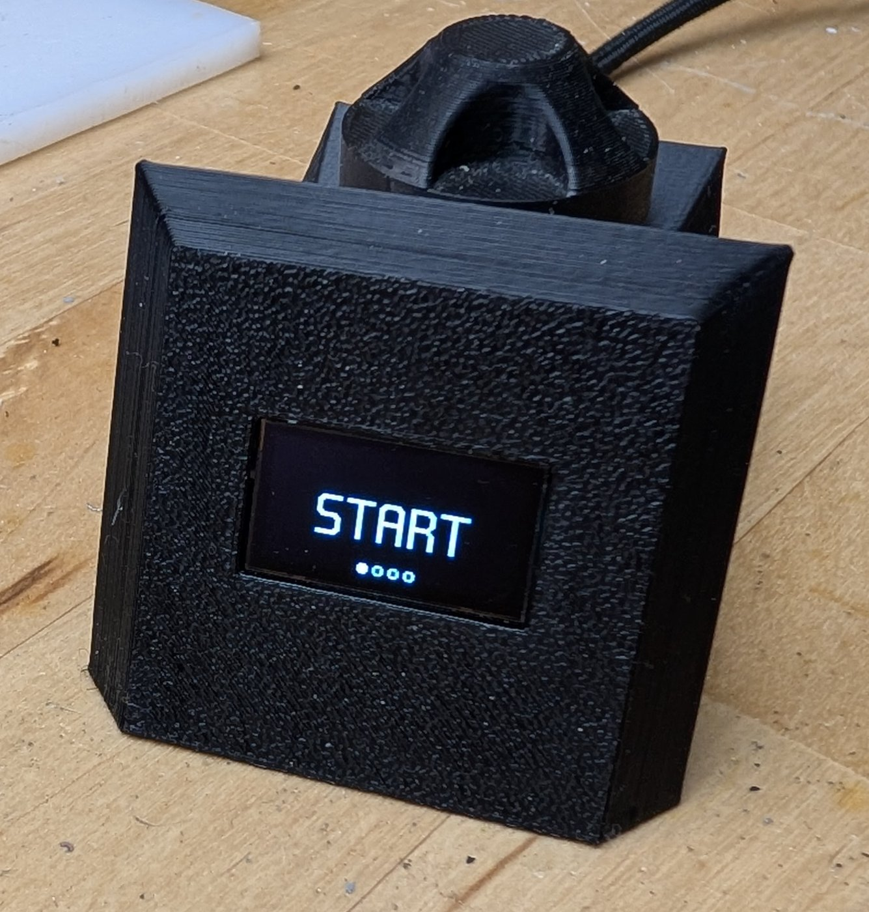
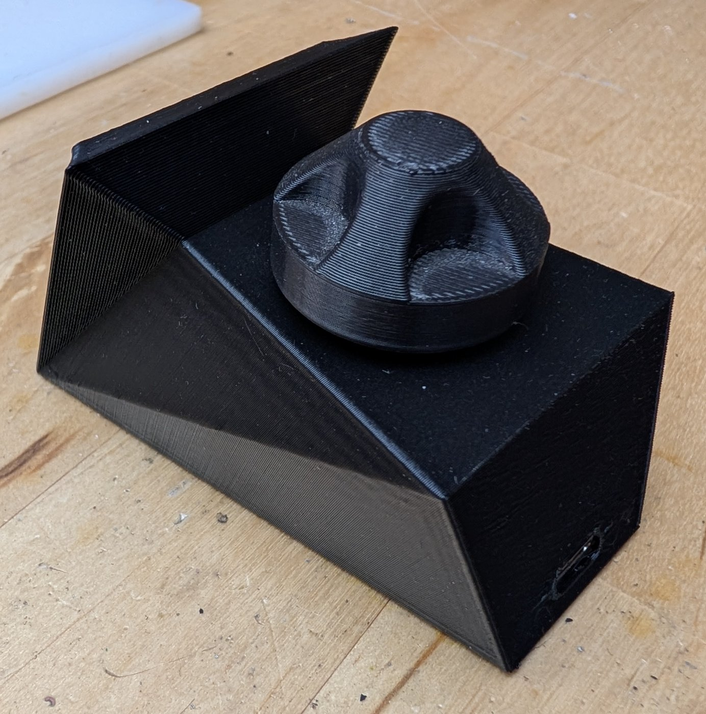
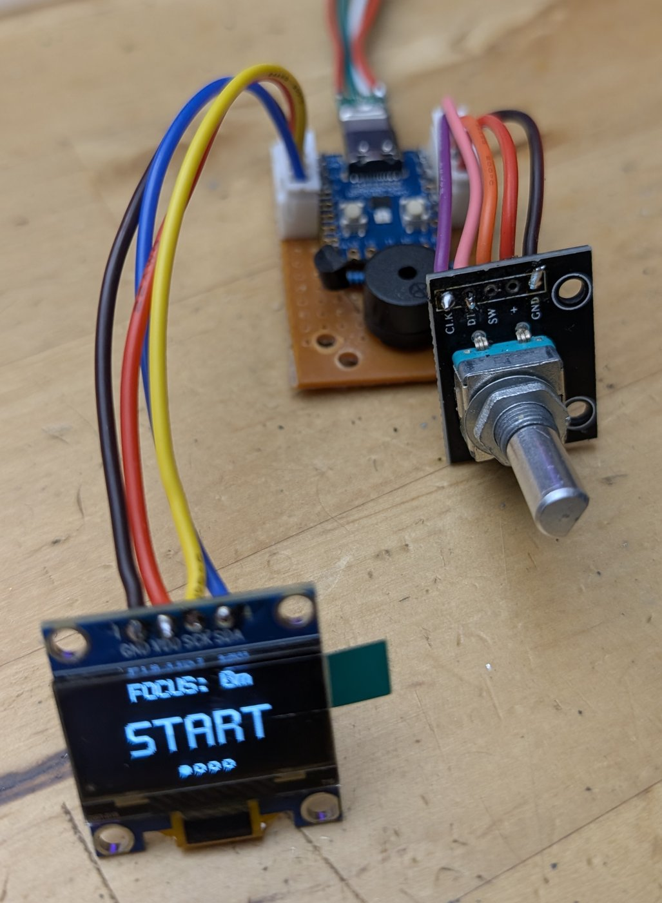
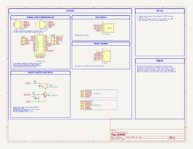
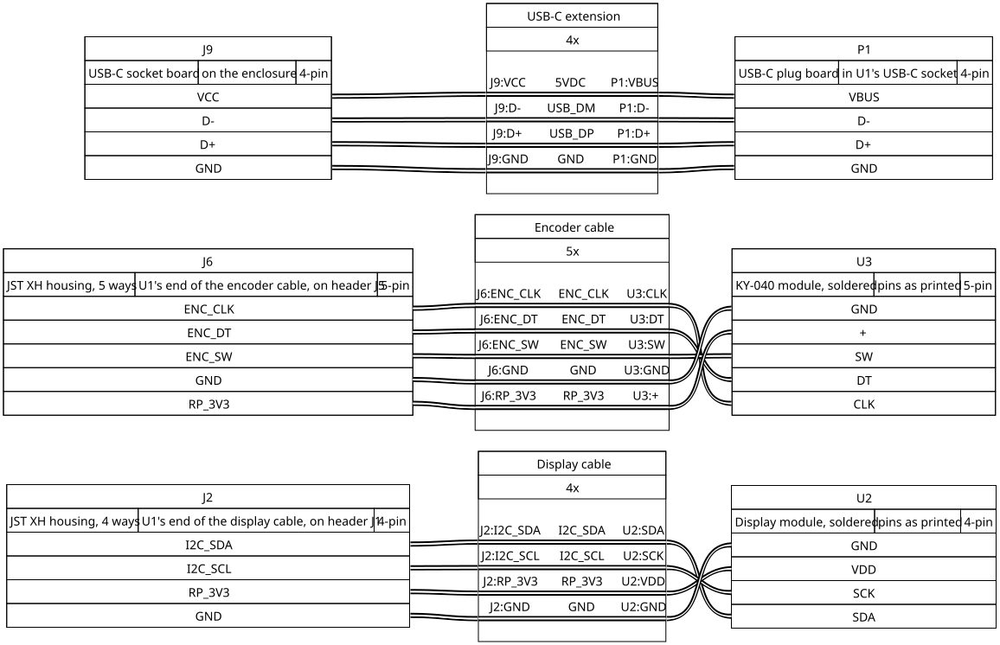

# G.E.R.A.R.D.

Gentleman's Efficient Reminder of Assiduity, Rehydration and Discipline: a desk focus timer that counts your focus time and keeps reminding you to take breaks, drink and stretch.



GERARD counts focus time up, or counts a set time down, on a small OLED display worked with one knob. After 30 minutes
of running time (by default, but that can be changed in the serial portal) it asks for a break so you can prevent having
back, eyes and brain problems. Like, seriously, stop working all crouched over your keyboard all day non-stop drinking
back-to-back energy drinks in a dark room. Get up, stretch a bit, look at something (ideally outside) at least 20 feet 
away for at least 2 minutes, and drink water, doofus.
GERARD sits on the desk and also keeps track of the time you've spent in focus. Bit of dopamine hit when you look at it
after a day's work and see the focus number went brr.

**Release version 1** (2026-11-09) · hardware revision A · firmware `v.1.0.20261109T161718Z`

## The device

I like names starting with G, and I needed a name for this device. Since its in the spirit of [IGOR](https://github.com/UrbanCircles/igor), the
focus timer that inspired it, I decided on a butler-esque name. So it became...
G.E.R.A.R.D. : **Gentleman's Efficient Reminder of Assiduity, Rehydration and Discipline**.

Also has nice animations, just for fun! Most are changing according to the amount of time between breaks.

## Specifications

- **Microcontroller:** RP2040-Zero.
- **Power:** USB-C connector.
- **Display:** white SSD1306 OLED module on I2C, 128 x 64.
- **Input:** rotary encoder.
- **Sound:** passive magnetic buzzer.
- **Enclosure:** two 3D-printed parts and a knob.
- **Firmware:** focus count-up, countdown from 1 to 240 minutes, break prompts, nine run animations, and a USB serial
  portal for settings and buzzer tunes.

## What is in this repository

| Path | What is there | Open first |
|---|---|---|
| [`hardware/`](hardware/) | The schematic (KiCad and PDF), the enclosure and knob (STLs) | [`gerard - Schematic.pdf`](hardware/kicad/gerard%20-%20Schematic.pdf) |
| [`firmware/`](firmware/) | The firmware source, using PlatformIO | [`src/pins.h`](firmware/src/pins.h) |
| [`docs/`](docs/) | The Hardware Bible and the Firmware Gospel, as PDF and Markdown, and their figures | [`GERARD - Hardware Bible.pdf`](docs/GERARD%20-%20Hardware%20Bible.pdf) |
| [`llms.txt`](llms.txt) | A map of this repository for an LLM | |
| `LICENSE-*` | The three licences, also in [`LICENSES/`](LICENSES/) | |

## Build it

1. Read the [Hardware Bible (PDF)](docs/GERARD%20-%20Hardware%20Bible.pdf): parts, circuits, wiring and enclosure.
2. Gather the parts in its parts table, also in [`docs/hardware-bible.md`](docs/hardware-bible.md).
3. Build the perfboard from the [schematic](hardware/kicad/gerard%20-%20Schematic.pdf).
4. Make the cables from the [cable drawing](docs/figures/gerard-cables.svg).
5. Print the [enclosure and knob](hardware/3d/).
6. Flash the firmware, as the [Firmware Gospel (PDF)](docs/GERARD%20-%20Firmware%20Gospel.pdf) says in "Build and
   flash".

## Flash the firmware

In a git clone of this repository (the version stamp reads git):

```sh
cd firmware
pio run
# Open and close the board's serial port at 1200 baud: it restarts into its USB bootloader.
picotool load -v -x .pio/build/gerard/firmware.uf2
```

The [Firmware Gospel (PDF)](docs/GERARD%20-%20Firmware%20Gospel.pdf), "Build and flash", gives the details.

## Documentation

| Book | For a human | For an LLM (because we're vibin') |
|---|---|---|
| Hardware Bible | [`GERARD - Hardware Bible.pdf`](docs/GERARD%20-%20Hardware%20Bible.pdf) | [`hardware-bible.md`](docs/hardware-bible.md) |
| Firmware Gospel | [`GERARD - Firmware Gospel.pdf`](docs/GERARD%20-%20Firmware%20Gospel.pdf) | [`firmware-gospel.md`](docs/firmware-gospel.md) |

An LLM agent can start from [`llms.txt`](llms.txt).

<details>
<summary>More pictures</summary>



Out of the enclosure, young and spry:







</details>

## Help

Found an error, or stuck on a step? Open an issue in this repository's [GitHub issues](../../issues).

## Credits

GERARD is inspired by [IGOR](https://github.com/UrbanCircles/igor), a focus timer by UrbanCircles.

## Licence

| Part | Licence |
|---|---|
| Hardware design (KiCad files, STL) | [CERN-OHL-S-2.0](LICENSE-CERN-OHL-S-2.0) |
| Firmware (everything in `firmware/`) | [GPL-3.0-or-later](LICENSE-GPL-3.0-or-later) |
| Documents (`docs/`, the READMEs, `llms.txt`) | [CC-BY-SA-4.0](LICENSE-CC-BY-SA-4.0) |

© 2026 Zeroshin.
